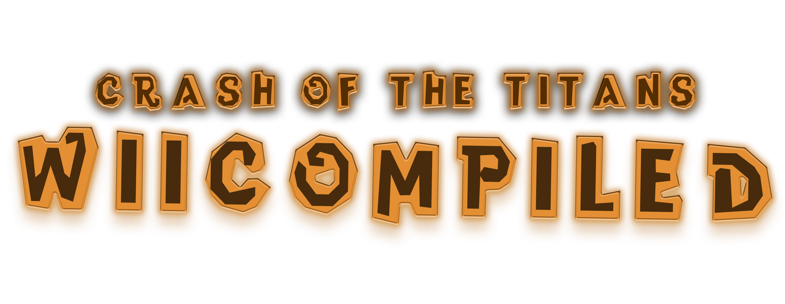

<div align="center">
  
  <p>A static recompilation of the Wii version of <em>Crash of the Titans</em> into a native Windows game.</p>
  <p>
    <a href="../../releases/latest"></a>
    <a href="LICENSE"></a>
  </p>
</div>

> [!IMPORTANT]
> The game is not included. You need your own Wii disc image of **Crash of the Titans**, PAL (`RQJP7D`) or NTSC USA
> (`RQJE7D`). The launcher builds the game on your PC from your disc; no game code or data is distributed.

The game's code is translated from PowerPC to C++ with [NWiiRecomp](https://github.com/BlackLineInteractive/NWiiRecomp)
and compiled with a high-level Wii runtime into a native program. It is not an emulator. Pre-release: launcher `0.1.0`,
builder `2026.10.23-10`.

| Release | Disc ID | Status |
| --- | --- | --- |
| PAL | `RQJP7D` | Playable |
| NTSC (USA) | `RQJE7D` | Playable |

**PAL is the recommended release.** It is the one tested and benchmarked, and its disc also carries three unfinished test
levels that the launcher can open from its Episodes page (the NTSC disc does not have them).

## Features

- **Two-player co-op.** A second controller joins at any time as Carbon Crash. Up to four controllers are recognised,
  and hot-plugging works.
- **Save states.** **F1** snapshots the game; **Play from here** on the launcher's Save states page resumes it.
- **Controls.** Per-player layouts on a Wii Remote and Nunchuk diagram, gyro or stick pointer, motion, live changes.
- **Episode select.** The Episodes page starts the game at any episode, or, with **Skip menus and cutscenes**, opens it
  straight in one past the boot movies and menus (the controller strap warning still shows). On the PAL disc it also lists
  the unfinished test levels (`CombatArena01`, `SoundTest`, `AI_pathfind`); most have little or no scenery. **Play** always
  starts the game normally.
- **Soundtrack.** Play and export every music and ambience track as WAV, with a favourites list.
- **Display.** 1x to 4x resolution, anisotropic filtering, borderless fullscreen (F11), 16:9, custom frame limit up to
  1000 FPS, frame pacing, six languages, and a shader cache.
  The **Frame pacing** switch in Settings applies while playing and saves automatically; turn it off to compare with the original wait method.
- **Discs.** `.iso`, `.wbfs`, `.rvz`, `.wia`, `.ciso` and `.gcz`, for either release.

## Performance

PAL, Ryzen 5 3600, RTX 3060, 2x resolution, 1280x720, 120 FPS limit:

| Scene | FPS |
| --- | --- |
| Menus | 120 (limit) |
| Most gameplay | 75 to 100 |
| Busiest fights | about 60 |

The game thread sets the speed and is single-threaded, so per-core speed matters most. NTSC has not been benchmarked yet.

## Requirements

| | Minimum | Recommended |
| --- | --- | --- |
| OS | Windows 10 or 11, 64-bit | Windows 11 |
| CPU | 4 cores, about 3 GHz, AVX2 and FMA3 | Ryzen 5 3600 or better |
| GPU | OpenGL 3.2 | GTX 1060 / RX 580 or better |
| Memory | 8 GB | 16 GB |
| Disk | 6 GB free | SSD |

Only the Ryzen 5 3600 and RTX 3060 are tested, on PAL; the rest are estimates. Without FMA3 the game exits at start.

## Quick start

1. Install `CrashLauncher-<version>-windows-x64-setup.exe` from the [latest release](../../releases/latest).
2. **Choose disc image…**, then **Start build** (once; this takes a while).
3. **Play**.

Keys: **F1** save state, **F3** performance overlay, **F4** export it, **F11** fullscreen. Saves and save states are
in `%APPDATA%\net.ghostesp.crash-launcher\profile\` and survive rebuilds.

<details>
<summary><b>Building from source</b></summary>

Needs Python 3.12+, [WinLibs](https://winlibs.com/) GCC 16 (POSIX, UCRT, with CMake and Ninja), Git and, for the
launcher, Rust with the Tauri CLI. Fetch NWiiRecomp at the pinned revision (the build refuses any other):

```powershell
git clone https://github.com/BlackLineInteractive/NWiiRecomp.git vendor/NWiiRecomp
git -C vendor/NWiiRecomp checkout 595f176f1d24cc54ff2e8389feed12d7fb553cc2
```

Launcher installer ([release workflow](.github/workflows/release.yml) does the same):

```powershell
python tools/make_builder_pack.py --mingw <winlibs folder>/mingw64
cd launcher/src-tauri
cargo test --release --lib
cargo tauri build --config tauri.bundle.conf.json
```

Game only: extract your disc into `game/` (so `game/sys/main.dol` exists), then:

```powershell
python tools/build_native.py --storage <build folder>
python tools/run_startup.py --exe <build folder>/toolchain/CrashNative.exe --window --clock wall --seconds 86400 --name play
```

Checks: `python tools/builder_revision.py` verifies the pinned stage inputs; after changing stages or overlays, run
`python launcher/scripts/refresh_builder.py`.

</details>

## Credits and legal

Built on [NWiiRecomp](https://github.com/BlackLineInteractive/NWiiRecomp) by Volodymyr Vovchok, with the audio backend
adapted from [Dolphin](https://github.com/dolphin-emu/dolphin). Third-party licences are in
[THIRD_PARTY_NOTICES.md](THIRD_PARTY_NOTICES.md). Much of this port was written with AI coding agents under human
direction and is checked by differential tests and play.

Unofficial fan project for research and preservation, not affiliated with or endorsed by any rights holder. Crash
Bandicoot, Crash of the Titans and related names and artwork belong to their owners. Free, non-commercial use only,
under the terms of [LICENSE](LICENSE), which does not cover game code or data, generated guest code, disc images,
saves or game artwork.
